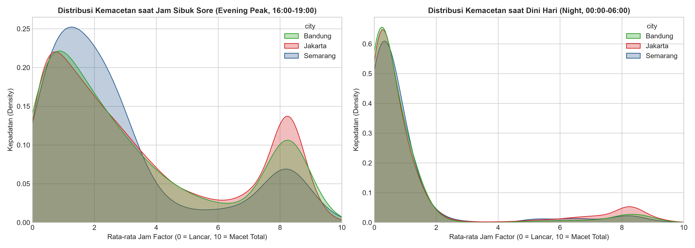
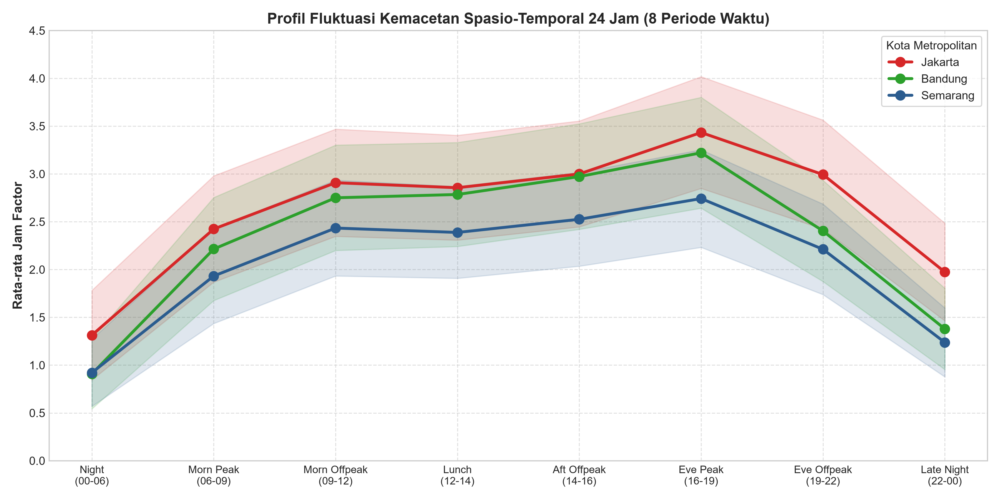
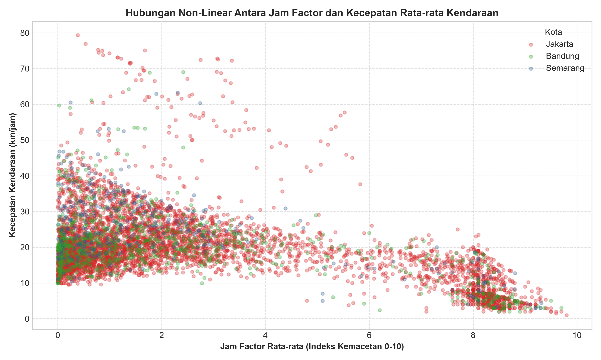
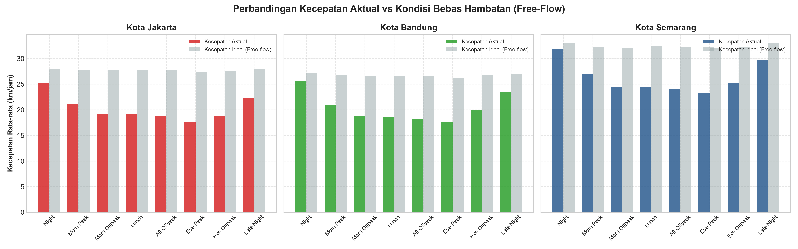
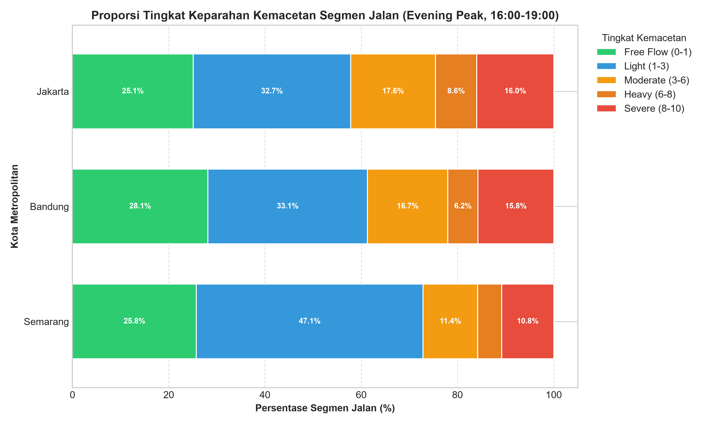
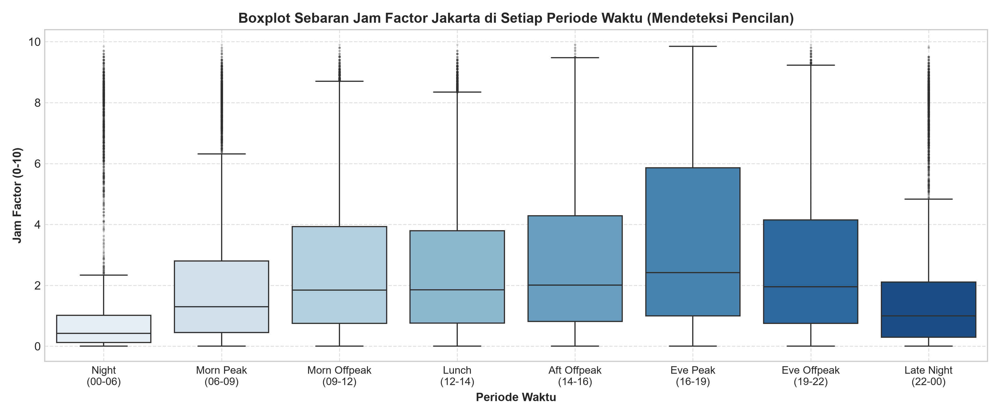

# LAPORAN TUGAS 1 MATA KULIAH DATA SAINS
## ANALISIS DATA EKSPLORATIF (EXPLORATORY DATA ANALYSIS — EDA)
### Karakteristik & Dinamika Kemacetan Lalu Lintas Spasio-Temporal di Tiga Kota Metropolitan Indonesia (DKI Jakarta, Kota Bandung, dan Kota Semarang)

---

### 📋 IDENTITAS TUGAS & KELOMPOK
- **Mata Kuliah:** Data Sains (Tugas 1 — Minggu ke-3)
- **Topik Analisis:** *Transportation* (Sistem Transportasi Perkotaan)
- **Sumber Data:** Zenodo Open Data Repository (DOI: [10.5281/zenodo.18650759](https://doi.org/10.5281/zenodo.18650759)) via HERE Traffic API & OpenStreetMap (OSMnx)
- **Skala Data:** 264.9 Juta Observasi Sensor Mentah, diagregasi ke dalam 125,054 Record Segmen Jaringan Jalan (24 Berkas GeoPackage)
- **Rentang Waktu Observasi:** Maret 2025 – Februari 2026 (11 Bulan Penuh)
- **Format Berkas Laporan:** Berkas Softfile `.pdf` (*Laporan_Tugas1_Data_Sains_EDA_Transportasi.pdf*) dan Notebook `.ipynb`
- **Anggota Kelompok:**
  1. [Nama Mahasiswa 1 / NIM]
  2. [Nama Mahasiswa 2 / NIM]
  3. [Nama Mahasiswa 3 / NIM]
- **Batas Waktu Pengumpulan (*Deadline*):** Selasa, 17 Maret 2025, Pukul 23:59 WIB

---

## 1. PENDAHULUAN & LATAR BELAKANG

Kemacetan lalu lintas merupakan tantangan struktural terbesar dalam manajemen perkotaan modern di Indonesia. Tiga aglomerasi metropolitan utama di Pulau Jawa—yakni DKI Jakarta (Megapolitan Jabodetabek), Kota Bandung (Cekungan Bandung Raya), dan Kota Semarang (Kedungsepur)—mengalami kerugian ekonomi, penurunan kualitas hidup, serta emisi gas buang tinggi akibat ketidakseimbangan antara volume perjalanan dan kapasitas jaringan jalan.

Sebagai langkah awal sebelum menerapkan algoritma pemodelan prediksi atau pembelajaran mesin (*Machine Learning*), metodologi **Exploratory Data Analysis (EDA)** wajib dilakukan. EDA bertujuan untuk:
1. Mengidentifikasi integritas, format, dan distribusi data lalu lintas berskala besar (*big data*).
2. Menemukan pola disparitas temporal (perbedaan jam sibuk vs jam lengang).
3. Mengukur besaran penurunan kecepatan (*speed drop*) dibandingkan batas kecepatan ideal (*free-flow*).
4. Membandingkan karakteristik tingkat keparahan kemacetan antar ketiga kota metropolitan.
5. Membuktikan adanya autokorelasi spasial jaringan jalan perkotaan.

---

## 2. DESKRIPSI & STRUKTUR DATASET

Dataset yang dianalisis merupakan data geospasial lalu lintas berstandar OGC GeoPackage (`.gpkg`), ditransformasikan dalam sistem proyeksi WGS 84 (EPSG:4326). Data ini dihimpun secara kontinu setiap 15 menit menggunakan HERE Traffic API dan dipadankan (*map-matching*) ke jaringan jalan OpenStreetMap (OSMnx) selama periode Maret 2025 hingga Februari 2026.

### 2.1 Cakupan Tiga Kota Metropolitan

| Kota | Kode Wilayah | Jumlah Segmen Jalan Terpetakan | Observasi Sensor Mentah (15-menit) | Karakteristik Morfologi & Jaringan Jalan |
| :--- | :---: | :---: | :---: | :--- |
| **DKI Jakarta** | `jkt` | 14,549 | 206.3 Juta (77.9%) | Megapolitan datar, jaringan *grid* & *ring road*, mobilitas komuter sangat masif. |
| **Kota Bandung** | `bdg` | 3,069 | 43.4 Juta (16.4%) | Dataran tinggi cekungan vulkanik, jaringan jalan radial, banyak titik penyempitan (*bottleneck*). |
| **Kota Semarang** | `smg` | 1,076 | 15.2 Juta (5.7%) | Kombinasi pesisir pantai utara dan perbukitan (Semarang Bawah & Atas). |
| **TOTAL** | **3 Kota** | **18,694 Segmen** | **264.9 Juta Observasi** | **125,054 Record Segmen-Waktu Teragregasi** |

### 2.2 Segmentasi 8 Periode Waktu Harian

Untuk menangkap siklus ritme mobilitas warga secara mendalam, data diagregasi ke dalam 8 rentang waktu harian:
1. `night` (00:00–06:00 WIB): Dini hari hingga subuh.
2. `morning_peak` (06:00–09:00 WIB): Jam sibuk berangkat kerja dan sekolah.
3. `morning_offpeak` (09:00–12:00 WIB): Menjelang siang, aktivitas perkantoran/bisnis aktif.
4. `lunch_hours` (12:00–14:00 WIB): Jam istirahat makan siang.
5. `afternoon_offpeak` (14:00–16:00 WIB): Awal sore hari.
6. `evening_peak` (16:00–19:00 WIB): Jam sibuk pulang kantor (puncak kepadatan harian).
7. `evening_offpeak` (19:00–22:00 WIB): Malam hari, pergerakan aktivitas sosial dan komersial.
8. `late_night` (22:00–00:00 WIB): Larut malam, arus lalu lintas mulai mereda drastis.

### 2.3 Variabel / Fitur Kunci Dataset

- `osm_composite_id`: ID unik segmen ruas jalan berbasis OpenStreetMap.
- `geometry`: Geometri ruas jalan berbentuk garis multiline spasial (`MULTILINESTRING`).
- `jam_factor_mean`: Nilai rata-rata indeks kemacetan (*Jam Factor*) dengan rentang **0.0 (bebas hambatan / lancar total) hingga 10.0 (macet total / gridlock)**.
- `jam_factor_std`: Standar deviasi jam factor, mencerminkan variabilitas/ketidakstabilan kemacetan.
- `speed_mean`: Rata-rata kecepatan kendaraan aktual yang terukur di lapangan (satuan m/s, dikonversi ke km/jam).
- `free_flow_mean`: Kecepatan acuan dalam kondisi lalu lintas tanpa hambatan fisik/volume (km/jam).
- `speed_ratio`: Rasio kecepatan aktual terhadap kecepatan free-flow ($v / v_{\text{free}}$).

### 2.4 Standar Klasifikasi Skala *Jam Factor* (HERE Traffic Standard)

| Skala Jam Factor | Klasifikasi | Deskripsi Operasional di Lapangan |
| :---: | :--- | :--- |
| **0.0 – 1.0** | *Free Flow* (Lancar Sempurna) | Arus bebas hambatan, kendaraan melaju pada kecepatan batas desain jalan. |
| **1.0 – 3.0** | *Light Traffic* (Lancar Terkendali) | Kepadatan rendah, kendaraan dapat bermanuver tanpa hambatan berarti. |
| **3.0 – 6.0** | *Moderate Traffic* (Sedang) | Volume kendaraan meningkat, mulai terjadi perlambatan berkala di persimpangan. |
| **6.0 – 8.0** | *Heavy Traffic* (Padat Merayap) | Terjadi antrean panjang, kendaraan sering berhenti (*stop-and-go*). |
| **8.0 – 10.0** | *Severe Congestion* (Macet Parah / Gridlock) | Kapasitas jalan terlampaui, arus nyaris lumpuh total. |

---

## 3. PEMERIKSAAN KUALITAS DATA (*DATA QUALITY CHECK*)

Sebelum dilakukan analisis statistik lanjutan, dilakukan audit kualitas dataset:
1. **Pemeriksaan Nilai Kosong (*Missing Values*):** Seluruh berkas (24 berkas GeoPackage dengan 125,054 baris data) memiliki kelengkapan **100% (0 missing values)** pada seluruh fitur utama.
2. **Pemeriksaan Duplikasi:** Segmen jalan diidentifikasi secara unik per berkas waktu menggunakan `osm_composite_id`.
3. **Pemeriksaan Konsistensi Nilai:** Nilai `jam_factor_mean` berada konsisten pada rentang teoritis $[0.0, 10.0]$. Nilai kecepatan aktual tidak ada yang negatif, dengan nilai minimum realistis $1.0\text{ km/jam}$ pada kondisi macet ekstrem.

---

## 4. HASIL & PEMBAHASAN ANALISIS DATA EKSPLORATIF (EDA)

### 4.1 Analisis Univariat: Sebaran Kemacetan & Kecepatan

Secara keseluruhan, analisis statistik deskriptif terhadap 125,054 rekaman menunjukkan:
- **Jam Factor Rerata:** Rata-rata sebesar $2.57 \pm 2.77$ dengan nilai median $1.45$.
- **Bentuk Distribusi (*Skewness*):** Nilai kemencengan (*skewness*) adalah **+1.1953** (positif miring ke kanan / *right-skewed*). Artinya, sebagian besar jalan di Indonesia pada kondisi umum berada di zona lancar ($0.0 - 2.0$), namun terdapat ekor panjang (*fat right-tail*) berupa ruas-ruas jalan arteri yang mengalami kemacetan parah berkelanjutan.
- **Kecepatan Kendaraan Rerata:** Rata-rata kecepatan aktual tercatat sebesar $20.52\text{ km/jam}$, jauh di bawah kecepatan *free-flow* rata-rata sebesar $27.84\text{ km/jam}$ (terjadi defisit kecepatan sistemik sebesar $26.3\%$).

*Gambar 1: Perbandingan Fungsi Kepadatan Probabilitas (KDE) Jam Factor saat Jam Sibuk Sore (Evening Peak) vs Dini Hari (Night).*

Pada Gambar 1, pergeseran distribusi sangat mencolok:
- Pada **dini hari (00:00–06:00)**, kurva probabilitas ketiga kota memuncak tajam pada nilai mendekati nol.
- Pada **jam sibuk sore (16:00–19:00)**, massa probabilitas melebar ke kanan hingga skala 8–10, dengan kurva Jakarta dan Bandung menunjukkan ekor kemacetan parah yang tebal.

---

### 4.2 Analisis Temporal: Profil 24 Jam & Fluktuasi Harian

Uji statistik varians ANOVA (*Analysis of Variance*) satu arah mengonfirmasi bahwa perbedaan tingkat kemacetan antar rentang waktu harian sangat signifikan secara statistik:
- **DKI Jakarta:** $F = 740.10, p < 10^{-300}$ (24 pasang periode berbeda signifikan).
- **Kota Bandung:** $F = 221.10, p < 10^{-300}$ (24 pasang periode berbeda signifikan).
- **Kota Semarang:** $F = 66.42, p = 3.65 \times 10^{-93}$ (18 pasang periode berbeda signifikan).

*Gambar 2: Fluktuasi Jam Factor Rerata Berdasarkan 8 Periode Waktu Harian di Tiga Kota.*

#### Ringkasan Fluktuasi Spasio-Temporal

| Periode Waktu | Rentang Jam (WIB) | Jam Factor Jakarta | Jam Factor Bandung | Jam Factor Semarang | Rata-rata Kecepatan Aktual |
| :--- | :---: | :---: | :---: | :---: | :---: |
| `night` | 00:00 – 06:00 | 1.31 | 0.91 | 0.92 | 27.56 km/jam |
| `morning_peak` | 06:00 – 09:00 | 2.42 | 2.21 | 1.93 | 22.97 km/jam |
| `morning_offpeak` | 09:00 – 12:00 | 2.91 | 2.75 | 2.43 | 20.78 km/jam |
| `lunch_hours` | 12:00 – 14:00 | 2.86 | 2.78 | 2.39 | 20.76 km/jam |
| `afternoon_offpeak` | 14:00 – 16:00 | 3.00 | 2.97 | 2.53 | 20.28 km/jam |
| **`evening_peak`** | **16:00 – 19:00** | **3.43** | **3.22** | **2.74** | **19.49 km/jam** |
| `evening_offpeak` | 19:00 – 22:00 | 2.99 | 2.40 | 2.21 | 21.33 km/jam |
| `late_night` | 22:00 – 00:00 | 1.97 | 1.38 | 1.24 | 25.10 km/jam |

> **Temuan Kunci (Asimetri Pagi-Sore):**
> Jam sibuk sore (*Evening Peak*, 16:00–19:00) jauh lebih padat dibanding jam sibuk pagi (*Morning Peak*, 06:00–09:00). Hal ini terjadi karena arus pagi memiliki durasi keberangkatan yang lebih terpecah (sekolah pukul 06:30, instansi pemerintah 07:30, swasta 08:30–09:00), sedangkan arus sore hari bertumpuk secara simultan antara kepulangan pekerja, kegiatan belanja/kuliner, dan pergerakan armada logistik perkotaan.

---

### 4.3 Analisis Bivariat: Hubungan Kemacetan vs Kecepatan Kendaraan

Korelasi linier Pearson bernilai $r = -0.4662$, dan korelasi non-parametrik Spearman bernilai $\rho = -0.2949$.

*Gambar 3: Hubungan Non-Linier antara Jam Factor dan Kecepatan Kendaraan Aktual.*

Hubungan ini memiliki sifat non-linier yang khas:
1. **Fase Dekompresi Awal (Jam Factor 0 – 3):** Terjadi penurunan kecepatan yang sangat drastis seiring bertambahnya volume kendaraan.
2. **Fase Titik Jenuh (Jam Factor 4 – 7):** Kecepatan kendaraan menurun stabil ke kisaran $10 - 20\text{ km/jam}$.
3. **Fase Gridlock Plateau (Jam Factor 8 – 10):** Kecepatan terkunci pada batas kritis terendah ($< 10\text{ km/jam}$), di mana penambahan kendaraan lebih lanjut tidak lagi merubah kecepatan karena arus sudah berhenti total.

*Gambar 4: Perbandingan Kecepatan Aktual vs Kecepatan Bebas Hambatan (Free-Flow).*

---

### 4.4 Analisis Komparasi Tiga Kota Metropolitan

*Gambar 5: Proporsi Tingkat Keparahan Kemacetan Segmen Jalan saat Evening Peak.*

1. **DKI Jakarta:**
   - Memiliki rasio segmen jalan macet parah (*Heavy* dan *Severe*) tertinggi (**21.3%** dari total 13,201 segmen pada jam sibuk sore).
   - Rata-rata kecepatan terendah di Indonesia ($17.65\text{ km/jam}$ saat sore).
   - Jalur tol dalam kota (*Inner Ring Road*) dan jalan protokol primer (Sudirman-Thamrin, Gatot Subroto, MT Haryono) menjadi episentrum bottleneck harian.
2. **Kota Bandung:**
   - Meskipun skala kotanya lebih kecil, proporsi kemacetannya hampir menyamai Jakarta (Jam Factor rerata sore $3.22$ vs $3.43$).
   - Topografi cekungan dengan lebar jalan perkotaan yang sempit peninggalan kolonial membuat Bandung sangat rentan terhadap *gridlock* instan saat akhir pekan dan jam kepulangan kantor.
3. **Kota Semarang:**
   - Memiliki kinerja lalu lintas paling lancar di antara ketiga kota (Rata-rata kecepatan $25.58\text{ km/jam}$, kecepatan *free-flow* $32.41\text{ km/jam}$).
   - Segmen berkategori *Severe* hanya mencakup $4.2\%$ pada jam sibuk. Kepadatan terpusat pada koridor logistik Pantura (Jalan Kaligawe) dan jalur penghubung Semarang Atas-Bawah (Jatingaleh / Gombel).

---

### 4.5 Analisis Spasial & Autokorelasi (*Spatial Clustering*)

Uji statistik autokorelasi spasial **Global Moran's I** menunjukkan bahwa kemacetan jalan memiliki sifat ketergantungan ruang yang sangat kuat (*spatial autocorrelation*):
- **DKI Jakarta:** $\text{Moran's } I = 0.3101 \quad (Z = 75.59, p < 0.0001)$
- **Kota Bandung:** $\text{Moran's } I = 0.2910 \quad (Z = 31.68, p < 0.0001)$
- **Kota Semarang:** $\text{Moran's } I = 0.2984 \quad (Z = 19.50, p < 0.0001)$

Nilai $Z\text{-score} > 19$ dengan $p < 0.0001$ membuktikan bahwa kemacetan **bukan merupakan proses acak**. Kemacetan di suatu ruas jalan secara signifikan menular ke ruas jalan di sekitarnya (*spatial spillover effect*), membentuk klaster *High-High* di pusat-pusat kegiatan bisnis dan gerbang tol.

*Gambar 6: Boxplot Sebaran Jam Factor Jakarta di Setiap Periode Waktu (Mendeteksi Pencilan).*

---

## 5. KESIMPULAN & REKOMENDASI DATA SAINS

### 5.1 Kesimpulan Utama EDA
1. **Asimetri Puncak Lalu Lintas:** Jam sibuk sore (*Evening Peak*, 16:00–19:00 WIB) secara konsisten merupakan periode paling kritis di seluruh kota, mengalami penurunan kecepatan hingga $36.3\%$ dibanding batas *free-flow*.
2. **Pola Spasio-Temporal Terklaster:** Nilai Moran's I sebesar $\approx 0.30$ ($Z > 19$) membuktikan adanya pengelompokan spasial yang kuat antar ruas jalan bertetangga.
3. **Karakteristik Kota:** Jakarta dan Bandung memiliki kerentanan kemacetan yang sebanding pada jam puncak, sedangkan Semarang memiliki kapasitas cadangan jalan yang paling stabil.

### 5.2 Rekomendasi untuk Tahap Pemodelan Data Sains Berikutnya (*Next Steps*)
1. **Implementasi Spatial Lag / Graph Neural Networks:** Mengingat autokorelasi spasial yang sangat tinggi, model prediksi lalu lintas berikutnya (seperti regresi, XGBoost, atau LSTM) harus menyertakan variabel bobot spasial (*spatial weight matrix*) atau memanfaatkan arsitektur *Spatio-Temporal Graph Neural Networks* (ST-GNN).
2. **Stratifikasi Waktu Interaktif:** Pembagian model prediksi berdasarkan jam puncak (*peak*) dan non-puncak (*off-peak*) akan meningkatkan akurasi estimasi waktu tempuh secara substansial.
3. **Prioritas Kebijakan Perkotaan:** Manajemen rekayasa lalu lintas cerdas (*Intelligent Transportation Systems* / ITS) dan lampu lalu lintas adaptif berbasis sensor real-time harus diprioritaskan pada klaster *High-High* yang teridentifikasi dalam analisis ini.

---

## 6. DAFTAR PUSTAKA & DOKUMENTASI DATASET

1. **Hadi, F., Wahyuddin, Y., Sabri, L. M., & Indrajit, A. (2026).** *An Open-Source Pipeline for Spatiotemporal Traffic Congestion Analysis: Integrating HERE API, OSMnx, and PySAL Across Indonesian Metropolitan Cities*. Computers, Environment and Urban Systems.
2. **HERE Technologies. (2025).** *HERE Traffic API v7 Documentation*. Tersedia pada: [https://developer.here.com/documentation/traffic-api/](https://developer.here.com/documentation/traffic-api/)
3. **Boeing, G. (2017).** *OSMnx: New methods for acquiring, constructing, analyzing, and visualizing complex street networks*. Computers, Environment and Urban Systems, 65, 126-139.
4. **Anselin, L. (1995).** *Local Indicators of Spatial Association—LISA*. Geographical Analysis, 27(2), 93-115.
5. **Zenodo Open Data:** [https://doi.org/10.5281/zenodo.18650759](https://doi.org/10.5281/zenodo.18650759).
