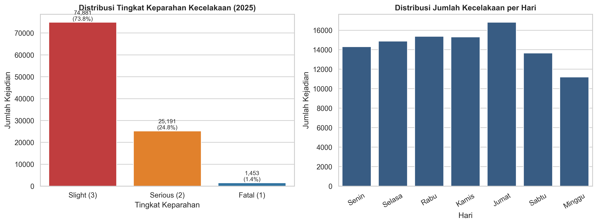
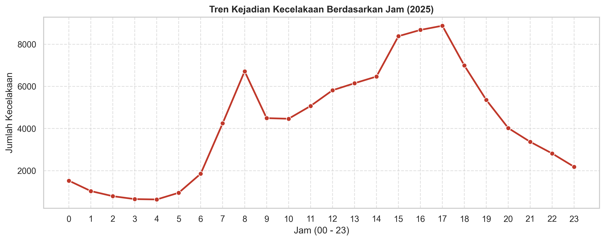
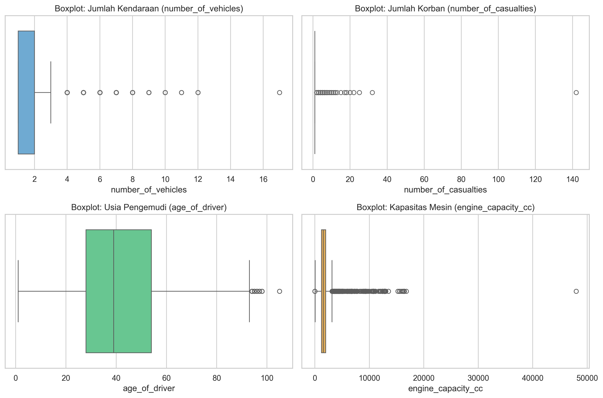
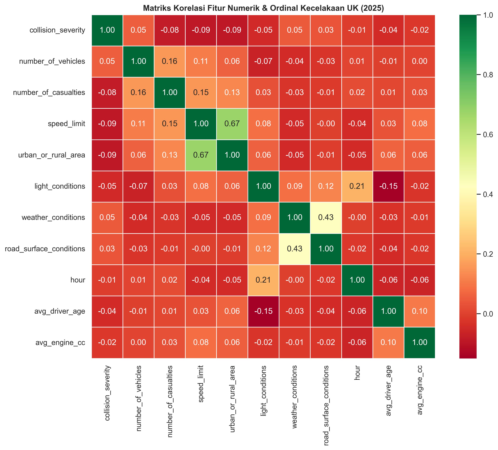

# TUGAS BESAR DATA SAINS
## STRUKTUR DATA, EXPLORATORY DATA ANALYSIS, DAN DATA PRE-PROCESSING DATASET UK ROAD SAFETY 2025

Disusun oleh:
- Maheswara Ariq Athallah (101032300050)
- Muhammad Al Qarnie (101032330043)
- Daffa Hermansyah (101032330090)

2026

---

## 1. Struktur Data
Dataset *UK Road Safety Statistics* tahun 2025 terdiri dari 3 tabel CSV dan 1 kamus data (*Data Guide* `.xlsx`):

| Tabel | Baris | Kolom | Kunci Penghubung | Cakupan Data |
| :--- | :---: | :---: | :--- | :--- |
| **Collision** | 101.525 | 44 | `collision_index` | Waktu, lokasi, batas kecepatan, cuaca, keparahan. |
| **Vehicle** | 183.948 | 32 | `collision_index`, `vehicle_reference` | Jenis kendaraan, kapasitas mesin, profil pengemudi. |
| **Casualty** | 127.883 | 23 | `collision_index`, `vehicle_reference`, `casualty_reference` | Usia, jenis kelamin, tingkat luka korban. |

- **Relasi:** Seluruh 101.525 kejadian di tabel *Collision* cocok **100%** dengan tabel *Vehicle* dan *Casualty* melalui `collision_index`.
- **Kode Khusus:** Nilai **`-1`** pada dataset berarti *data kosong / tidak tersedia*.
- **Penyesuaian Tipe Data:** Dataset berbentuk **data tabel (tabular)**, sehingga teknik data citra (*Image Segmentation*) tidak diterapkan.

---

## 2. Exploratory Data Analysis (EDA)

### 2.1 Distribusi Keparahan dan Pola Waktu
- **Tingkat Keparahan:** Kecelakaan ringan (*Slight*) **74.881 (73,76%)**, serius (*Serious*) **25.191 (24,81%)**, dan fatal (*Fatal*) **1.453 (1,43%)**.
- **Pola Waktu:** Tertinggi pada hari **Jumat (16.811 kasus)** dan pukul **17:00 (8.877 kasus)** saat jam pulang kerja; terendah pada hari **Minggu (11.197 kasus)** dan pukul **04:00 pagi (634 kasus)**.

### 2.2 Deteksi Outlier (Metode IQR & Boxplot)
Nilai `-1` dikecualikan dari perhitungan IQR agar tidak mengganggu deteksi nilai ekstrem:

| Fitur Numerik | Q1 | Q3 | Batas Atas | Jumlah Outlier | Persentase | Maksimum |
| :--- | :---: | :---: | :---: | :---: | :---: | :---: |
| `number_of_vehicles` | 1,0 | 2,0 | 3,5 | 1.939 | 1,91% | 17 kendaraan |
| `number_of_casualties` | 1,0 | 1,0 | 1,0 | 18.208 | 17,93% | 142 korban |
| `speed_limit` | 30,0 | 40,0 | 55,0 | 18.309 | 18,03% | 70 mph |
| `age_of_driver` | 28,0 | 54,0 | 93,0 | 65 | 0,04% | 105 tahun |
| `engine_capacity_cc` | 1.200 | 1.984 | 3.160 | 6.146 | 4,42% | 48.000 cc |
| `age_of_casualty` | 23,0 | 53,0 | 98,0 | 7 | 0,01% | 105 tahun |

*Catatan:* Nilai ekstrem tersebut merupakan kejadian nyata (misal tabrakan beruntun 17 kendaraan, kecelakaan bus 142 korban, atau jalan tol 70 mph), bukan error data, sehingga tetap dipertahankan.

### 2.3 Analisis Korelasi & Fitur yang Digunakan
- **Fitur Dikeluarkan:** Kolom ID (`collision_index`, `collision_ref_no`), konstan (`collision_year`), dan kode wilayah acak (`police_force`, `local_authority_district`).
- **11 Fitur Masuk Korelasi:** `collision_severity`, `number_of_vehicles`, `number_of_casualties`, `speed_limit`, `urban_or_rural_area`, `light_conditions`, `weather_conditions`, `road_surface_conditions`, `hour`, `avg_driver_age`, dan `avg_engine_cc`.
- **Korelasi Terkuat:**
  1. `speed_limit` vs `urban_or_rural_area` (**+0,67**): jalan luar kota/pedesaan memiliki batas kecepatan lebih tinggi.
  2. `weather_conditions` vs `road_surface_conditions` (**+0,43**): cuaca buruk langsung membuat permukaan jalan basah/licin.
  3. `light_conditions` vs `hour` (**+0,21**): jam kejadian memengaruhi kondisi pencahayaan alami.

---

## 3. Data Pre-processing

1. **Selection & Merging:** Mengambil 13 fitur utama tabel *Collision* + rata-rata `age_of_driver` dan `engine_capacity_cc` dari tabel *Vehicle* via `collision_index` → dimensi awal **101.525 × 16**.
2. **Cleaning & Validation:**
   - Cek duplikasi: **0 data ganda**.
   - Konversi kode `-1` → `NaN` dan validasi rentang nilai logis (`speed_limit` 1–70 mph, `age_of_driver` 10–105 tahun).
   - **Penghapusan kolom kosong:** Fitur `age_of_vehicle` pada data 2025 seluruhnya bernilai `-1` (**100% kosong**), sehingga kolom tersebut dihapus.
3. **Imputasi Missing Values:**
   - **Numerik** (`avg_driver_age` 6.087 kosong; `avg_engine_cc` 13.670 kosong) diisi **Median** (40 tahun & 1.560 cc) karena tahan terhadap *outlier*.
   - **Kategorikal** (`road_surface_conditions` 634; `light_conditions` 16; `urban_or_rural_area` 4) diisi **Modus**.
   - **Hasil:** Total *missing values* = **0**.
4. **One-Hot Encoding:** Diterapkan menggunakan `OneHotEncoder` pada 5 fitur kategorikal nominal (`road_type`, `weather_conditions`, `light_conditions`, `road_surface_conditions`, `urban_or_rural_area`) agar tidak dianggap sebagai angka berurutan. Dimensi dataset berubah dari **101.525 × 16** menjadi **101.525 × 39** (+28 kolom biner `0`/`1`).

---

## 4. Kesimpulan
Dataset *UK Road Safety* 2025 (101.525 kejadian) telah melewati seluruh tahap struktur data, EDA (distribusi, *outlier* IQR, korelasi 11 fitur), dan *pre-processing* (*cleaning*, validasi, penghapusan `age_of_vehicle`, imputasi median/modus, serta *One-Hot Encoding*). Dataset akhir berukuran **101.525 × 39 kolom** dalam kondisi bersih (0 duplikasi, 0 *missing values*) dan siap digunakan untuk tahap *Machine Learning* pada UAS.

**Referensi:**
1. UK Department for Transport (2025). *Road Safety Open Data & Data Guide 2025*.
2. Materi Kuliah Data Sains & Analisis (Pak Surya `Week 3–6` & LMS `Pertemuan 01, 04–07, 09`).
