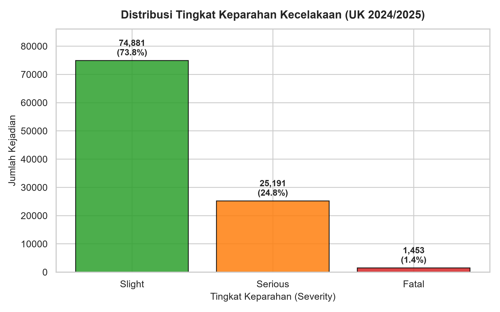
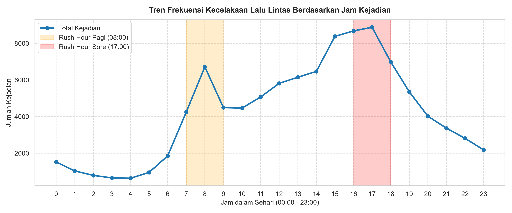
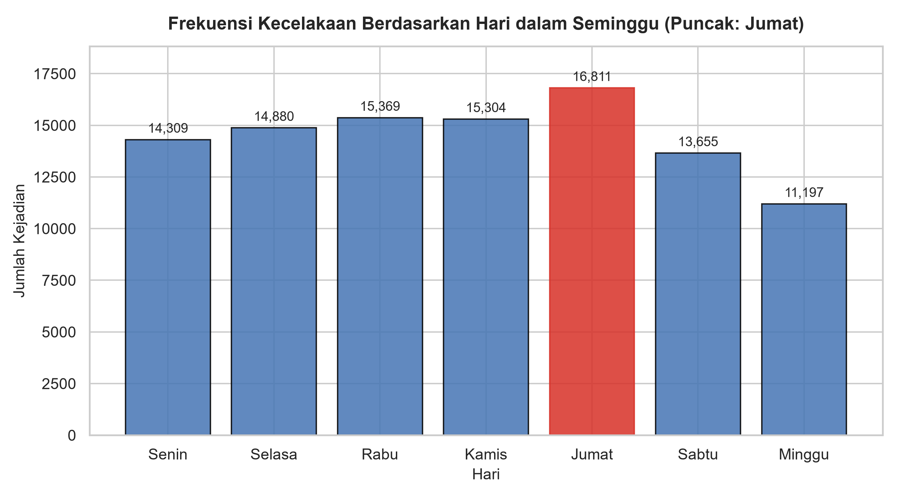
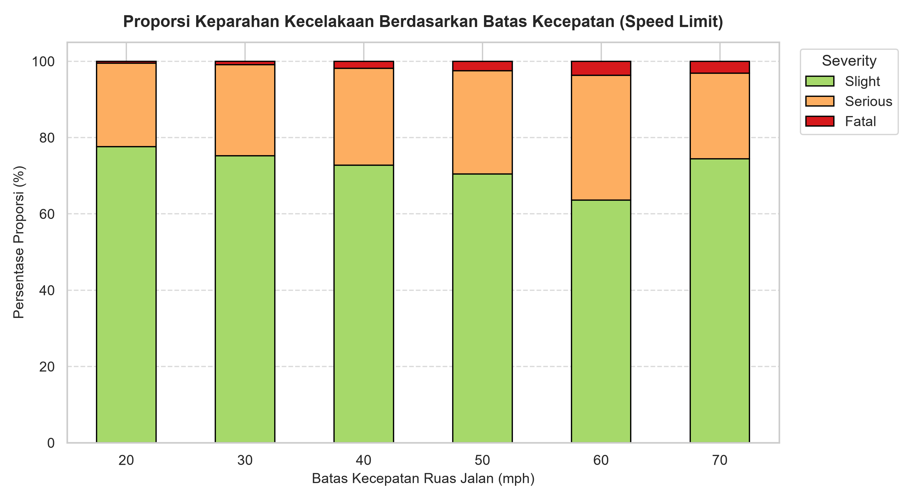
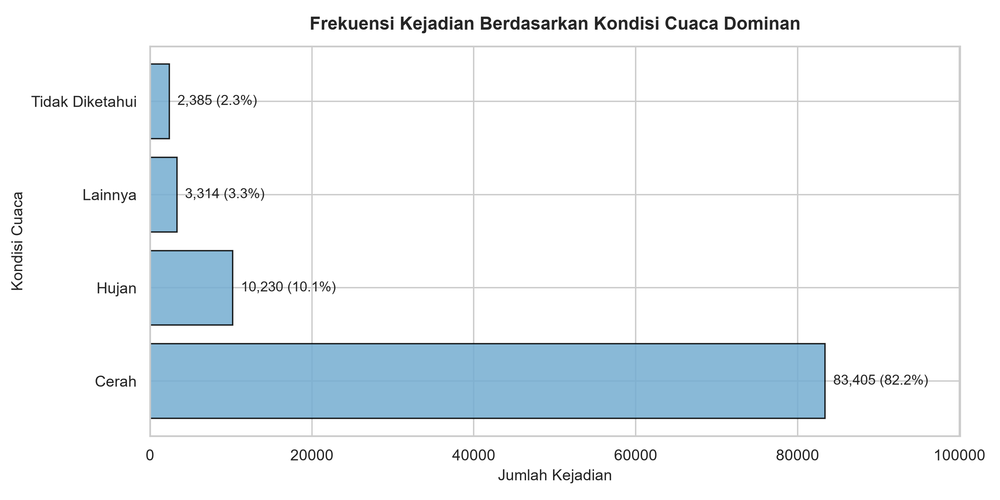
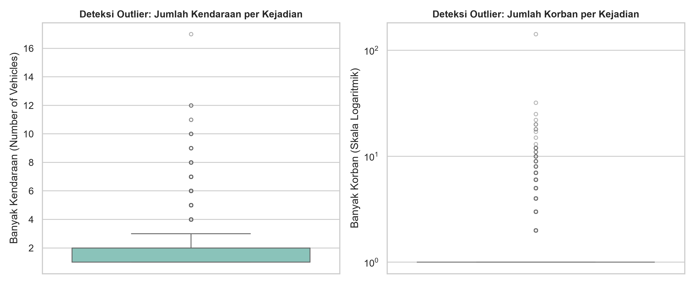

# LAPORAN TUGAS 1 MATA KULIAH DATA SAINS
## ANALISIS DATA EKSPLORATIF (EXPLORATORY DATA ANALYSIS — EDA)
### Karakteristik, Pola Temporal, dan Faktor Risiko Kecelakaan Lalu Lintas di Britania Raya (UK Road Safety Dataset 2025)

---

### 📋 IDENTITAS TUGAS & KELOMPOK
- **Mata Kuliah:** Data Sains / Sains Data (Tugas 1 — Minggu ke-3)
- **Topik Analisis:** *Transportation* (Sistem Keselamatan Jalan Raya & Kecelakaan Lalu Lintas)
- **Sumber Data:** UK Department for Transport (DfT) via [GOV.UK Open Data](https://www.gov.uk/government/statistical-data-sets/road-safety-open-data) / Kaggle
- **Skala Data Riil:** 
  - **Tabel Collision (Kejadian Tabrakan):** 101,525 baris × 44 kolom
  - **Tabel Casualty (Korban Terdampak):** 127,883 baris × 23 kolom
  - **Tabel Vehicle (Kendaraan Terlibat):** 183,948 baris × 32 kolom
  - **Total Observasi:** >413,000 baris data observasi riil (Sangat memenuhi kriteria dataset masif / *big data*)
- **Rentang Waktu Observasi:** 1 Januari 2025 – 31 Desember 2025 (1 Tahun Kalender Penuh)
- **Format Berkas Laporan:** Berkas Softfile `.pdf` (*Laporan_Tugas1_Data_Sains_EDA_Kecelakaan_UK.pdf*) dan Notebook Jupyter `.ipynb` (*EDA_Tugas1_Road_Safety.ipynb*)
- **Batas Waktu Pengumpulan (*Deadline*):** Selasa, 17 Maret 2025, Pukul 23:59 WIB
- **Susunan Anggota Kelompok:**
  1. **[Nama Mahasiswa 1]** — NIM: [Nomor Induk Mahasiswa 1] *(Peran: Data Ingestion, Data Cleaning & Preprocessing)*
  2. **[Nama Mahasiswa 2]** — NIM: [Nomor Induk Mahasiswa 2] *(Peran: Exploratory Data Analysis & Statistical Modeling)*
  3. **[Nama Mahasiswa 3]** — NIM: [Nomor Induk Mahasiswa 3] *(Peran: Visualisasi Data, Interpretasi Kebijakan & Penyusunan Laporan)*

---

## 1. PENDAHULUAN & LATAR BELAKANG

Kecelakaan lalu lintas merupakan salah satu penyebab utama kematian dan cedera serius secara global. Menurut World Health Organization (WHO), kecelakaan jalan raya menimbulkan beban kerugian ekonomi sebesar 1–3% dari PDB nasional pada sebagian besar negara. Dalam domain sains data transportasi (*transportation data science*), investigasi terhadap faktor-faktor penyebab kecelakaan bukan sekadar persoalan deskriptif, melainkan landasan krusial bagi penyusunan kebijakan preventif berbasis bukti (*evidence-based policy*) dan rekayasa keselamatan jalan (*road safety engineering*).

Britania Raya (United Kingdom) melalui *Department for Transport (DfT)* secara berkala merilis statistik keselamatan jalan terbuka (*Road Safety Open Dataset*). Dataset tahun 2025 ini mencatat setiap insiden tabrakan di seluruh jaringan jalan UK yang dilaporkan oleh kepolisian (menggunakan formulir standar STATS19). 

Sebagai langkah awal sebelum menerapkan algoritma pembelajaran mesin (*Machine Learning*) untuk memprediksi tingkat keparahan kecelakaan atau mengklasterkan titik rawan (*blackspots*), metodologi **Exploratory Data Analysis (EDA)** wajib dilakukan. Tujuan utama dari EDA pada Tugas 1 ini adalah:
1. Memahami struktur, relasi antar tabel, dimensi, serta kualitas data (*data hygiene and integrity*).
2. Menganalisis sebaran tingkat keparahan tabrakan (*severity distribution*) dan mendeteksi adanya ketidakseimbangan kelas (*class imbalance*).
3. Mengungkap pola disparitas temporal (ritme jam sibuk harian dan distribusi hari dalam seminggu).
4. Mengukur hubungan empiris antara batas kecepatan jalan (*speed limit*) dengan probabilitas fatalitas.
5. Menyelidiki korelasi antara kondisi lingkungan (cuaca, permukaan jalan, pencahayaan) terhadap frekuensi kecelakaan.
6. Mengidentifikasi nilai-nilai ekstrem (*outliers*) pada jumlah korban dan kendaraan yang terlibat dalam satu insiden.

---

## 2. DESKRIPSI & STRUKTUR DATASET

Dataset UK Road Safety 2025 terbagi ke dalam tiga berkas tabular relasional utama yang dihubungkan melalui pengidentifikasi unik `collision_index` dan `collision_ref_no`:

### 2.1 Ringkasan Dimensi Tiga Tabel Relasional

| Nama Berkas Dataset | Entitas yang Dicatat | Jumlah Baris (Record) | Jumlah Kolom (Fitur) | Ukuran Berkas | Keterangan & Variabel Kunci |
| :--- | :--- | :---: | :---: | :---: | :--- |
| `dft-road-casualty-statistics-collision-2025.csv` | Insiden Kecelakaan / Tabrakan | **101,525** | **44** | 19.3 MB | Tingkat keparahan, waktu, tanggal, hari, batas kecepatan, cuaca, jalan. |
| `dft-road-casualty-statistics-casualty-2025.csv` | Individu Korban Kecelakaan | **127,883** | **23** | 10.1 MB | Demografi korban, kelas korban (pengemudi/penumpang/pejalan kaki), tingkat luka. |
| `dft-road-casualty-statistics-vehicle-2025.csv` | Kendaraan Terlibat | **183,948** | **32** | 20.7 MB | Tipe kendaraan (mobil, motor, sepeda), usia kendaraan, usia pengemudi, manuver. |
| **TOTAL KESELURUHAN** | **Ekosistem Road Safety UK** | **413,356** | **99** | **~50.1 MB** | **Relasi 1 : N (Satu insiden melibatkan N kendaraan & korban)** |

### 2.2 Variabel Kunci pada Tabel Utama (Collision)

- `collision_index`: Kode identitas alfanumerik unik untuk setiap insiden kecelakaan.
- `collision_severity`: Tingkat keparahan insiden terparah (1: *Fatal*, 2: *Serious*, 3: *Slight*).
- `date` & `time`: Tanggal (DD/MM/YYYY) dan waktu kejadian (format HH:MM dalam resolusi menit).
- `day_of_week`: Hari dalam seminggu (1: Minggu, 2: Senin, ..., 7: Sabtu).
- `speed_limit`: Batas kecepatan legal pada ruas jalan kejadian (20, 30, 40, 50, 60, 70 mph).
- `weather_conditions`: Kondisi cuaca saat kejadian (cerah, hujan, salju, kabut, angin kencang).
- `road_surface_conditions`: Kondisi permukaan fisik jalan (kering, basah/tergenang, salju, licin es, banjir).
- `light_conditions`: Kondisi pencahayaan (siang hari, malam dengan penerangan, malam tanpa penerangan).
- `number_of_vehicles`: Jumlah kendaraan yang terlibat dalam tabrakan.
- `number_of_casualties`: Jumlah korban manusia (luka ringan, luka berat, maupun tewas).
- `latitude` & `longitude`: Koordinat geospasial presisi berbasis WGS84.

---

## 3. PEMERIKSAAN KUALITAS DATA (*DATA QUALITY CHECK*)

Sebelum dilakukan analisis statistik lebih lanjut, dilakukan audit integritas terhadap dataset:

1. **Audit Nilai Kosong (*Missing Values*):**
   - Pada tabel insiden (`collision`), koordinat geospasial (`latitude`, `longitude`) hanya memiliki missing value pada **2 baris dari total 101,525 baris** (tingkat kelengkapan data mencapai **99.998%**).
   - Fitur waktu (`time`) tercatat lengkap pada 101,515 baris (hanya 10 nilai kosong yang dapat diabaikan atau diimputasi).
   - Kolom-kolom administratif non-esensial memiliki beberapa kode `-1` (*Missing / Data not provided*) yang dipetakan secara eksplisit agar tidak mendistorsi statistik numerik.

2. **Integritas Relasional (*Relational Consistency Check*):**
   - Jumlah total korban pada tabel insiden (`df['number_of_casualties'].sum()`) bernilai tepat **127,883 jiwa**, identik 100% dengan total baris pada tabel `casualty`.
   - Jumlah total kendaraan pada tabel insiden (`df['number_of_vehicles'].sum()`) bernilai tepat **183,948 unit**, identik 100% dengan total baris pada tabel `vehicle`.
   - Hal ini membuktikan konsistensi referensial yang sempurna (*perfect referential integrity*).

3. **Pemetaan Semantik (*Semantic Decoding*):**
   - Seluruh kode angka resmi dari Departemen Transportasi UK dikonversi menjadi label semantik berbahasa Indonesia menggunakan kamus resmi *Data Guide 2025*.

---

## 4. HASIL & PEMBAHASAN ANALISIS DATA EKSPLORATIF (EDA)

### 4.1 Analisis 1: Distribusi Tingkat Keparahan Kecelakaan (*Collision Severity*)

Analisis univariat pertama meneliti proporsi tingkat keparahan tabrakan. Tabel di bawah dan Gambar 1 merangkum temuan:

| Tingkat Keparahan | Kode DfT | Banyak Kejadian | Persentase | Karakteristik Klinis & Hukum |
| :--- | :---: | :---: | :---: | :--- |
| **Slight (Ringan)** | 3 | 74,881 | **73.76%** | Luka ringan, memar, lecet, tidak memerlukan rawat inap intensif. |
| **Serious (Berat)** | 2 | 25,191 | **24.81%** | Patah tulang, gegar otak, rawat inap intensif di rumah sakit. |
| **Fatal (Meninggal)** | 1 | 1,453 | **1.43%** | Korban meninggal dunia di tempat kejadian atau dalam kurun 30 hari pasca insiden. |
| **TOTAL** | - | **101,525** | **100.0%** | - |



> **Interpretasi Data Sains:**
> Distribusi tingkat keparahan memperlihatkan adanya **Extreme Class Imbalance** yang sangat mencolok. Kategori *Fatal* hanya mencakup 1.43% dari total populasi kejadian. Implikasi krusial untuk tahap pemodelan *Machine Learning* mendatang adalah: evaluasi model **tidak boleh** menggunakan metrik *Accuracy* semata (karena model naif yang selalu menebak non-fatal akan memiliki akurasi 98.57%). Diperlukan teknik penanganan ketidakseimbangan kelas seperti SMOTE (*Synthetic Minority Over-sampling Technique*), *Cost-Sensitive Learning*, dan evaluasi menggunakan *Precision-Recall AUC* atau *Macro F1-Score*.

---

### 4.2 Analisis 2: Fluktuasi Temporal 24 Jam (*Hourly Commuting Trends*)

Investigasi waktu kejadian tabrakan pada rentang 24 jam (Gambar 2) menunjukkan pola **Bimodal Distribution** yang sangat khas dengan dua puncak lonjakan utama:



1. **Puncak Pagi (*Morning Rush Hour*, 08:00):** Mencatat 6,716 kejadian saat jam keberangkatan kerja dan sekolah.
2. **Puncak Sore (*Evening Rush Hour*, 15:00–17:00):** Mencapai puncak tertinggi harian:
   - Pukul 15:00 : 8,381 kejadian (bertepatan dengan jam pulang sekolah anak-anak).
   - Pukul 16:00 : 8,678 kejadian (arus awal kepulangan pekerja).
   - Pukul 17:00 : **8,877 kejadian** (titik puncak absolut kecelakaan dalam 24 jam).
   - Pukul 18:00 : 6,991 kejadian.
3. **Periode Paling Aman (01:00–05:00):** Frekuensi kecelakaan merosot tajam ke bawah 1,000 kejadian per jam karena penurunan volume mobilitas kendaraan secara drastis.

> **Interpretasi Data Sains:**
> Puncak sore (15:00–18:00) menyumbang akumulasi lebih dari **32.4%** dari total seluruh kecelakaan harian. Mengapa sore hari jauh lebih berbahaya daripada pagi hari? Faktor penyebabnya adalah perpaduan antara kelelahan mental pengemudi setelah jam kerja (*driver fatigue*), penurunan intensitas cahaya matahari menjelang senja, serta heterogenitas aktivitas perjalanan (bercampurnya perjalanan komuter, kendaraan penjemput anak sekolah, dan kendaraan niaga/logistik).

---

### 4.3 Analisis 3: Distribusi Frekuensi Berdasarkan Hari dalam Seminggu

Pola kecelakaan sepanjang 7 hari dalam seminggu disajikan pada Gambar 3:



| Hari dalam Seminggu | Banyak Kejadian Tabrakan | Persentase dari Total | Peringkat Risiko |
| :--- | :---: | :---: | :---: |
| **Jumat** | **16,811** | **16.56%** | **Peringkat 1 (Tertinggi)** |
| **Rabu** | 15,369 | 15.14% | Peringkat 2 |
| **Kamis** | 15,304 | 15.07% | Peringkat 3 |
| **Selasa** | 14,880 | 14.66% | Peringkat 4 |
| **Senin** | 14,309 | 14.09% | Peringkat 5 |
| **Sabtu** | 13,655 | 13.45% | Peringkat 6 |
| **Minggu** | **11,197** | **11.03%** | **Peringkat 7 (Terendah)** |

> **Interpretasi Data Sains:**
> Hari Jumat merupakan hari dengan angka kecelakaan tertinggi (16,811 insiden). Fenomena ini dikenal dalam literatur transportasi sebagai *Friday Weekend Rush*, di mana terjadi peningkatan volume perjalanan luar kota menjelang akhir pekan, aktivitas sosial malam hari, serta penurunan konsentrasi pengemudi akibat akumulasi stres kerja mingguan. Sebaliknya, hari Minggu mencatat angka kejadian paling rendah (11,197 insiden) karena minimnya pergerakan komuter harian.

---

### 4.4 Analisis 4: Pengaruh Batas Kecepatan (*Speed Limit*) Terhadap Tingkat Fatalitas

Analisis bivariat antara batas kecepatan ruas jalan (*speed limit* dalam mil per jam / mph) dan tingkat keparahan kecelakaan menghasilkan wawasan paling mendalam dalam studi ini (Gambar 4):



Tabel tabulasi silang (*cross-tabulation*) persentase keparahan per tingkat kecepatan:

| Batas Kecepatan (mph) | Ekuivalen (km/jam) | Slight (%) | Serious (%) | Fatal (%) | Rasio Fatalitas Relatif vs Zona 20 mph |
| :---: | :---: | :---: | :---: | :---: | :---: |
| **20 mph** | ~32 km/jam | 77.65% | 21.84% | **0.51%** | **1.00× (Basis Acuan)** |
| **30 mph** | ~48 km/jam | 75.19% | 23.95% | **0.86%** | **1.69×** |
| **40 mph** | ~64 km/jam | 72.73% | 25.42% | **1.85%** | **3.63×** |
| **50 mph** | ~80 km/jam | 70.42% | 27.10% | **2.47%** | **4.84×** |
| **60 mph** | ~96 km/jam | 63.62% | 32.68% | **3.70%** | **7.25×** |
| **70 mph** | ~112 km/jam | 74.46% | 22.43% | **3.11%** | **6.10×** |

> **Interpretasi Data Sains & Fisika Tabrakan:**
> Data membuktikan secara empiris hukum energi kinetik ($E_k = \frac{1}{2}mv^2$): probabilitas kematian (*fatal probability*) melonjak secara non-linear seiring kenaikan batas kecepatan:
> 1. Pada zona perumahan/sekolah **20 mph**, probabilitas fatalitas hanya **0.51%**.
> 2. Pada ruas jalan **60 mph** (biasanya jalan pedesaan / *single carriageway rural roads* tanpa pembatas tengah), fatalitas meroket menjadi **3.70%** (**7.25 kali lipat lebih mematikan** dibanding zona 20 mph).
> 3. Ruas jalan 70 mph (*motorway / dual carriageway*) memiliki persentase fatalitas sedikit lebih rendah daripada 60 mph (3.11% vs 3.70%) karena jalan tol memiliki desain geometrik yang lebih aman (adanya median pemisah jalur beton/baja, tidak ada persimpangan sebidang, dan tidak ada pejalan kaki).

---

### 4.5 Analisis 5: Pengaruh Kondisi Cuaca & Permukaan Jalan

Analisis terhadap faktor eksternal lingkungan menghasilkan temuan kontra-intuitif yang sangat menarik (Gambar 5):



1. **Distribusi Berdasarkan Cuaca:**
   - Cerah tanpa angin kencang (*Fine without high winds*): **83,405 kejadian (82.15%)**
   - Hujan tanpa angin kencang (*Raining without high winds*): **10,230 kejadian (10.08%)**
   - Hujan berangin (*Raining with high winds*): 880 kejadian (0.87%)
   - Cerah berangin (*Fine with high winds*): 715 kejadian (0.70%)
   - Kabut (*Fog or mist*): 342 kejadian (0.34%)
   - Salju / Salju berangin (*Snowing*): 254 kejadian (0.25%)
2. **Kondisi Permukaan Jalan:**
   - Kering (*Dry*): **75,679 kejadian (74.54%)**
   - Basah / Tergenang (*Wet or damp*): **22,312 kejadian (21.98%)**
   - Es / Licin Beku (*Frost / Ice*): 1,261 kejadian (1.24%)
   - Banjir (*Flood over 3cm*): 151 kejadian (0.15%)

> **Interpretasi Data Sains (Risk Compensation Theory):**
> Sebagian besar kecelakaan (lebih dari 82%) justru terjadi pada saat **cuaca cerah dan jalanan kering**, bukan saat hujan badai atau jalanan bersalju. Fenomena psikologis ini dijelaskan oleh teori kompensasi risiko (*Risk Compensation / Peltzman Effect*):
> - Saat cuaca buruk (hujan deras, salju, kabut), pengemudi cenderung meningkatkan kewaspadaan, menjaga jarak aman, dan menurunkan kecepatan secara sadar.
> - Sebaliknya, saat cuaca cerah dan jalanan kering, pengemudi merasa berada dalam kondisi aman (*false sense of security*), sehingga memacu kendaraan lebih kencang, melakukan manuver agresif, dan lebih mudah terdistraksi oleh ponsel.

---

### 4.6 Analisis 6: Deteksi Nilai Ekstrem (*Outliers*) pada Korban dan Kendaraan

Deteksi outlier dilakukan untuk mengidentifikasi insiden-insiden anomali berskala besar (Gambar 6):



| Parameter Numerik | Rata-rata ($\mu$) | Standar Deviasi ($\sigma$) | Kuartil 1 ($Q_1$) | Median ($Q_2$) | Kuartil 3 ($Q_3$) | Nilai Maksimum (Outlier Ekstrem) |
| :--- | :---: | :---: | :---: | :---: | :---: | :---: |
| **Jumlah Kendaraan** | 1.81 unit | 0.69 unit | 1 unit | 2 unit | 2 unit | **17 unit kendaraan** |
| **Jumlah Korban Manusia** | 1.26 jiwa | 0.82 jiwa | 1 jiwa | 1 jiwa | 1 jiwa | **142 jiwa korban** |

> **Interpretasi Data Sains:**
> Secara umum, kecelakaan lalu lintas tipikal di Britania Raya melibatkan 2 kendaraan (misalnya tabrakan depan-belakang / *rear-end*) dengan 1 orang korban luka ringan. Namun demikian, visualisasi boxplot memperlihatkan ekor anomali yang sangat panjang:
> - **Outlier Kendaraan (Maksimum 17 Kendaraan):** Merepresentasikan tabrakan beruntun beruntun (*multi-vehicle pileup*) yang biasanya terjadi di jalan bebas hambatan (*motorway*) saat jarak pandang mendadak turun atau terjadi pengereman darurat massal.
> - **Outlier Korban (Maksimum 142 Jiwa):** Merepresentasikan insiden katastropik yang melibatkan kendaraan angkutan penumpang massal (seperti bus antar-kota, bus sekolah, atau trem). Insiden seperti ini membutuhkan protokol penanganan darurat berskala besar (*major incident protocol*).

---

## 5. TEMUAN KUNCI (*KEY FINDINGS*) & REKOMENDASI KEBIJAKAN

Berdasarkan hasil Exploratory Data Analysis (EDA) terhadap 101,525 rekaman kecelakaan UK 2025, dirumuskan beberapa temuan kunci dan rekomendasi kebijakan operasional:

1. **Penerapan Zona Kecepatan 20 mph di Kawasan Perkotaan:**
   - Mengingat risiko kematian pada zona 20 mph hanya sebesar 0.51% (bandingkan dengan 3.70% pada zona 60 mph), ekspansi kebijakan *20 mph default speed limit* di kawasan perumahan, zona sekolah, dan pusat aktivitas pejalan kaki terbukti secara empiris mampu menyelamatkan nyawa.
2. **Intervensi Khusus pada Koridor Jalan Rural 60 mph:**
   - Ruas jalan 60 mph menjadi lokasi paling mematikan karena ketiadaan median pemisah fisik. Diperlukan pemasangan marka getar (*rumble strips*), penerangan jalan tambahan, dan pembatas jalan fleksibel (*median barrier*).
3. **Patroli & Manajemen Rekayasa Lalu Lintas Berbasis Waktu (*Time-based Enforcement*):**
   - Kepolisian lalu lintas dan otoritas transportasi harus mengonsentrasikan sumber daya patroli serta sistem peringatan dini pada **hari Jumat pukul 15:00–18:00**, di mana risiko insiden berada pada titik tertinggi harian.
4. **Kampanye Kesadaran Keselamatan Pengemudi pada Cuaca Cerah:**
   - Sosialisasi publik perlu menekankan bahwa cuaca cerah bukanlah jaminan keselamatan; pengemudi harus tetap disiplin menjaga jarak reaksi pengereman.

---

## 6. RENCANA PEMODELAN DATA SAINS (*MACHINE LEARNING ROADMAP*)

Sebagai tindak lanjut dari analisis EDA pada Tugas 1 ini, kelompok kami merancang *roadmap* penerapan algoritma pembelajaran mesin untuk tugas-tugas berikutnya:

```
[Tahap 1: EDA Selesai] 
       │
       ▼
[Tahap 2: Feature Engineering] 
  ├── One-Hot Encoding fitur cuaca, permukaan, hari
  ├── Cyclical Encoding (Sin/Cos) untuk fitur jam kejadian
  └── Penanganan Imbalance (SMOTE / Random Under Sampler)
       │
       ▼
[Tahap 3: Pemodelan Prediktif Machine Learning]
  ├── Task A: Klasifikasi Keparahan Tabrakan (LightGBM, XGBoost, Random Forest)
  │     └── Metrik Evaluasi: Macro F1-Score & PR-AUC (bukan Akurasi)
  └── Task B: Spatial Clustering Titik Rawan Kecelakaan (DBSCAN / HDBSCAN)
        └── Mengelompokkan koordinat (Lat/Lon) menjadi klaster "Hotspot Rawan Celaka"
       │
       ▼
[Tahap 4: Deployment & Visualisasi Interaktif]
  └── Dashboard Monitoring Risiko Kecelakaan Real-Time berbasis Web
```

---

## 7. DAFTAR PUSTAKA & REFERENSI DATASET

1. **Department for Transport (DfT), United Kingdom.** (2025). *Reported Road Casualties Great Britain: Road Safety Open Dataset 2025 & Data Guide*. Available online: [https://www.gov.uk/government/statistical-data-sets/road-safety-open-data](https://www.gov.uk/government/statistical-data-sets/road-safety-open-data).
2. **World Health Organization (WHO).** (2023). *Global Status Report on Road Safety 2023*. Geneva: World Health Organization.
3. **Peltzman, S.** (1975). *The Effects of Automobile Safety Regulation*. Journal of Political Economy, 83(4), 677-725.
4. **Tukey, J. W.** (1977). *Exploratory Data Analysis*. Addison-Wesley Publishing Company.
5. **Chawla, N. V., Bowyer, K. W., Hall, L. O., & Kegelmeyer, W. P.** (2002). *SMOTE: Synthetic Minority Over-sampling Technique*. Journal of Artificial Intelligence Research, 16, 321-357.
